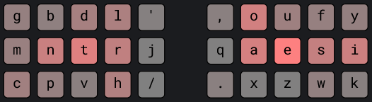

# gork layout family
minimal lateral index movement

## Layouts
<details>
<summary><b>gork-mntr</b></summary>
  
> ~ monterey jack

This layout slaps


```
g p d l ‘   , o u f y
m n t r j   q a e s i
c b v h /   . x z w k
```
[Playground](https://cyanophage.github.io/playground.html?layout=gpdl%27%2Coufy-mntrjqaesi%3Dcbvh%2F.xzwk%5C*%3B&mode=ergo&lan=english&thumb=l)


<b>Notes:</b>\
\+ qh4f\
− ijerf

<b>Optional Swaps:</b>
<dl><dd>
<details>
<summary><b>jq-swap</b></summary>
  
> ~ monterey queso

Switches the middle index keys so the left index has slightly less lateral movement (-0.08%), at the expense of the right index.\
Better for people with less mobility in the left index finger.


```
g p d l ‘   , o u f y
m n t r q   j a e s i
c b v h /   . x z w k
```
[Playground](https://cyanophage.github.io/playground.html?layout=gpdl%27%2Coufy-mntrjqaesi%3Dcbvh%2F.xzwk%5C*%3B&mode=ergo&lan=english&thumb=l)


<b>Notes:</b>\
\+ qh4f\
− ijerf

</details>

---

</dl></dd>

---

</details>


<details>
<summary><b>gork-sntr</b></summary>
  
> ~ sinatra jazz

This layout slaps


```
b f d l ‘   , o u y g
s n t r j   q a e i c
v p m h /   . x z k w
```
[Playground](https://cyanophage.github.io/playground.html?layout=gpdl%27%2Coufy-mntrjqaesi%3Dcbvh%2F.xzwk%5C*%3B&mode=ergo&lan=english&thumb=l)


<b>Notes:</b>\
\+ qh4f\
− ijerf

<b>Optional Swaps:</b>
<dl><dd>
<details>
<summary><b>jq-swap</b></summary>
  
> ~ sinatra quotes

Switches the middle index keys so the left index has slightly less lateral movement (-0.08%), at the expense of the right index.\
Better for people with less mobility in the left index finger.


```
g p d l ‘   , o u f y
m n t r q   j a e s i
c b v h /   . x z w k
```
[Playground](https://cyanophage.github.io/playground.html?layout=gpdl%27%2Coufy-mntrjqaesi%3Dcbvh%2F.xzwk%5C*%3B&mode=ergo&lan=english&thumb=l)


<b>Notes:</b>\
\+ qh4f\
− ijerf

</details>

---

</dl></dd>

---

</details>


## Credits
- [oxeylyzer](https://github.com/o-x-e-y/oxeylyzer) by o-x-e-y
- [playground](https://cyanophage.github.io/playground.html) by cyanophage


<br>
<br>
