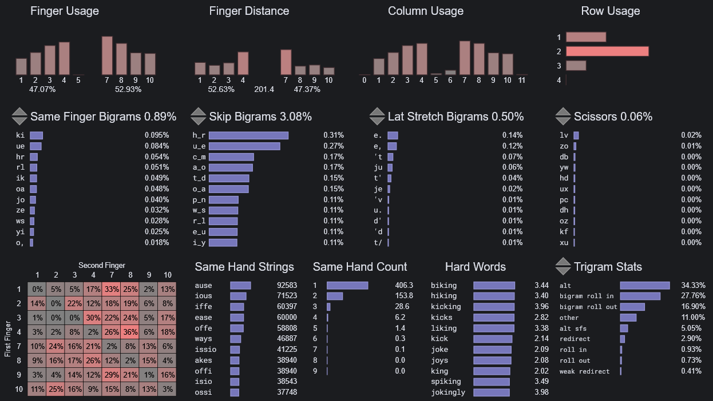
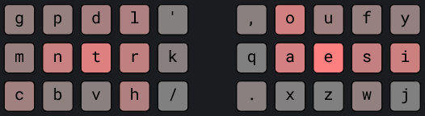
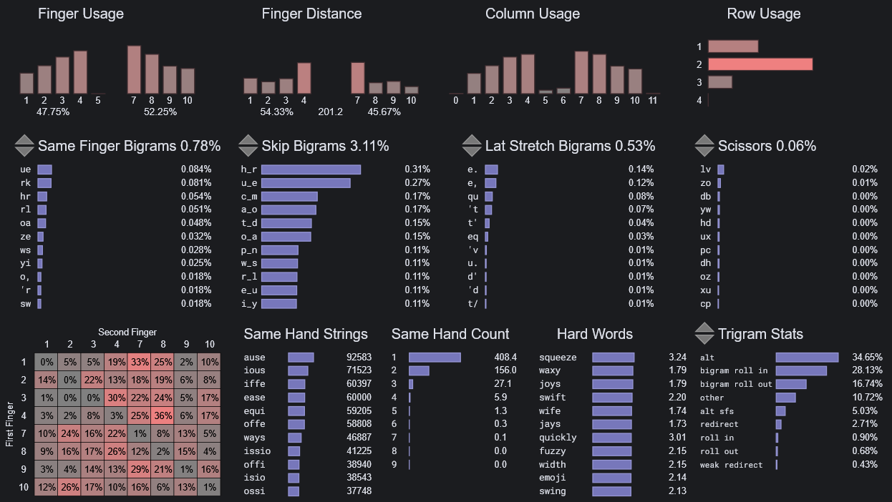
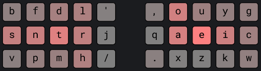
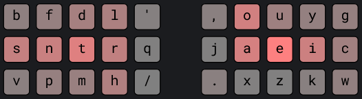
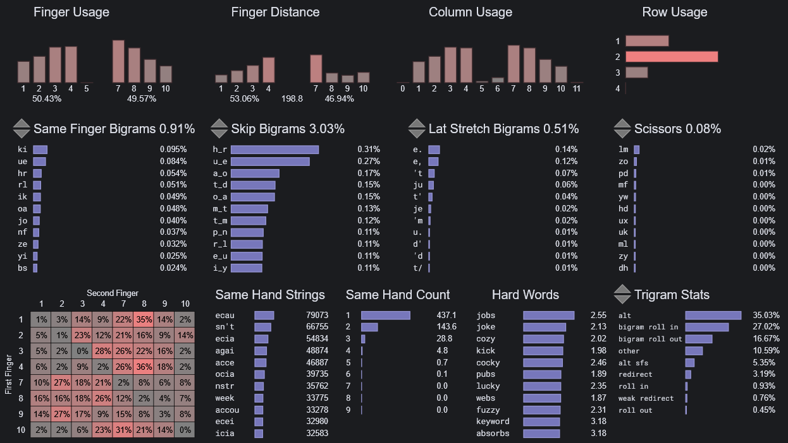
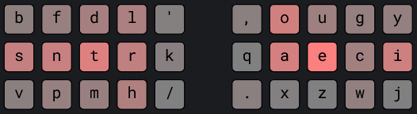
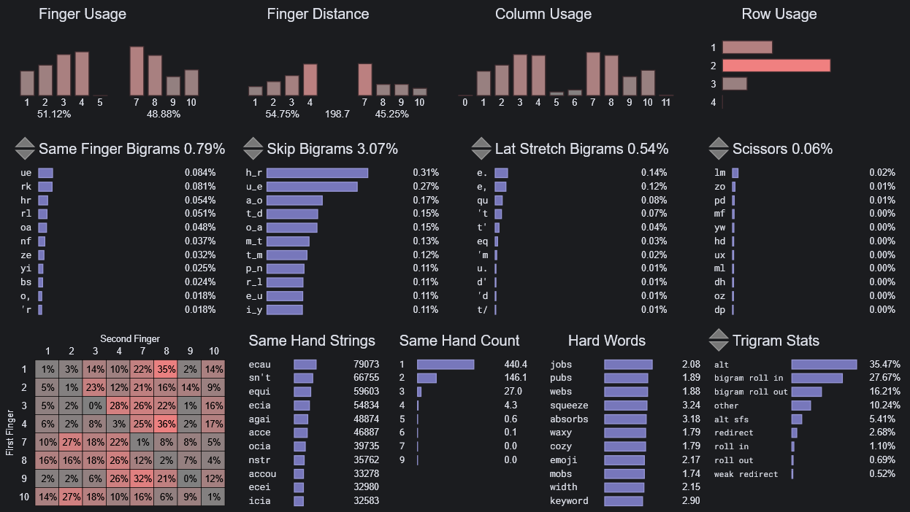

# gork-layouts
minimal lateral index movement

## Layouts
<details open>
<summary><b>gork-mntr</b></summary>
  
> ~ monterey jack

This layout slaps


```
g p d l ‘   , o u f y
m n t r j   q a e s i
c b v h /   . x z w k
```
[Playground](https://cyanophage.github.io/playground.html?layout=gpdl%27%2Coufy-mntrjqaesi%3Dcbvh%2F.xzwk%5C*%3B&mode=ergo&lan=english&thumb=l)


<b>Notes:</b>\
\+ Minimal center column use\
\+ Lower scissors (-0.52% vs graphite, gallium, canary)\
\+ Sloped finger usage\
− Much higher skip bigrams (+2.91% vs graphite, gallium, canary)\
− Slightly higher SFB (+0.15% vs graphite, gallium, canary)\
− Right pinky usage (10%)

<b>Optional Swaps:</b>
<dl><dd>

<!-- JQ Swap -->
<details>

<summary><b>q-swap</b></summary>
  
> ~ monterey queso

Switches the middle index keys so the left index has slightly less lateral movement (-0.08%), at the expense of the right index.\
Better for people with less mobility in the left index finger.


```
g p d l ‘   , o u f y
m n t r q   j a e s i
c b v h /   . x z w k
```
[Playground](https://cyanophage.github.io/playground.html?layout=gpdl%27%2Coufy-mntrqjaesi%3Dcbvh%2F.xzwk%5C*%3B&mode=ergo&lan=english&thumb=l)



<b>Costs:</b> marginal\
~ marginally lower left index lateral movement (-0.08%)\
~ marginally higher right index lateral (+0.08%)\
− SFB marginally higher (+0.08%)

---

</details>

<!-- JK Swap -->
<details>

<summary><b>k-swap</b></summary>
  
> ~ monterey kelp

Moves `k` from the right pinky to the center key of the left index for slightly lower right pinky use and marginally higher stats, at the cost of more lateral movement (+0.6%).\
Better for people with less mobility in the right pinky who don't mind an increase in lateral index movement.


```
g p d l ‘   , o u f y
m n t r k   q a e s i
c b v h /   . x z w j
```
[Playground](https://cyanophage.github.io/playground.html?layout=gpdl%27%2Coufy-mntrkqaesi%3Dcbvh%2F.xzwj%5C*%3B&mode=ergo&lan=english&thumb=l)



<b>Costs:</b> low\
\+ Slightly lower right pinky use (-0.6%)\
\+ Removes "ki" bigram\
\+ SFB marginally lower (-0.03%)\
− Slightly higher left index lateral movement (+0.6%)

---

</details>


<!-- MISC -->
<details>

<summary><b>misc</b></summary>

Other swaps with minimal costs. Generally, swapping the top and bottom keys on the same finger or two infrequent keys generally have low to no costs, but should be checked on [playground](https://cyanophage.github.io/playground).

`c - g`\
`b - p`\
`dl - vh`

`k - y`\
`k - q`\
`ouf - xzw`\
`fsw - yik`

</details>


</dl></dd>

---

</details>


<!-- SNTR -->


<details>
<summary><b>gork-sntr</b></summary>
  
> ~ sinatra jazz

This layout slaps


```
b f d l ‘   , o u y g
s n t r j   q a e i c
v p m h /   . x z k w
```
[Playground](https://cyanophage.github.io/playground.html?layout=bfdl%27%2Couyg-sntrjqaeic%3Dvpmh%2F.xzkw%5C*%3B&mode=ergo&lan=english&thumb=l)


<b>Notes:</b>\
\+ qh4f\
− ijerf

<b>Optional Swaps:</b>
<dl><dd>


<!-- JQ Swap -->
<details>

<summary><b>q-swap</b></summary>
  
> ~ sinatra quotes

Switches the middle index keys so the left index has slightly less lateral movement (-x.xx%), at the expense of the right index.\
Better for people with less mobility in the left index finger.


```
b f d l ‘   , o u y g
s n t r q   j a e i c
v p m h /   . x z k w
```
[Playground](https://cyanophage.github.io/playground.html?layout=bfdl%27%2Couyg-sntrqjaeic%3Dvpmh%2F.xzkw%5C*%3B&mode=ergo&lan=english&thumb=l)



<b>Costs:</b>\
~ lower left index lateral movement (-x.xx%)\
~ higher right index lateral (+x.xx%)\
~ SFB (±x.xx%)

---

</details>


<!-- JK Swap -->
<details>

<summary><b>k-swap</b></summary>
  
> ~ sinatra kick

Swaps the right ring and pinky columns, and moves `k` to the center key of the left index (`j` takes its old spot at the bottom of the right pinky).


```
b f d l ‘   , o u g y
s n t r k   q a e c i
v p m h /   . x z w j
```
[Playground](https://cyanophage.github.io/playground.html?layout=bfdl%27%2Cougy-sntrkqaeci%3Dvpmh%2F.xzwj%5C*%3B&mode=ergo&lan=english&thumb=l)



<b>Costs:</b>\
~ left index lateral movement (±x.xx%)\
~ right pinky use (±x.xx%)\
~ SFB (±x.xx%)

---

</details>


<!-- MISC -->
<details>

<summary><b>misc</b></summary>

Other swaps with minimal costs. Generally, swapping the top and bottom keys on the same finger or two infrequent keys generally have low to no costs, but should be checked on [playground](https://cyanophage.github.io/playground).

`x - x`\


</details>

</dd></dl>

---

</details>


## Credits
- [oxeylyzer](https://github.com/o-x-e-y/oxeylyzer) by o-x-e-y
- [playground](https://cyanophage.github.io/playground.html) by cyanophage


<br>
<br>
